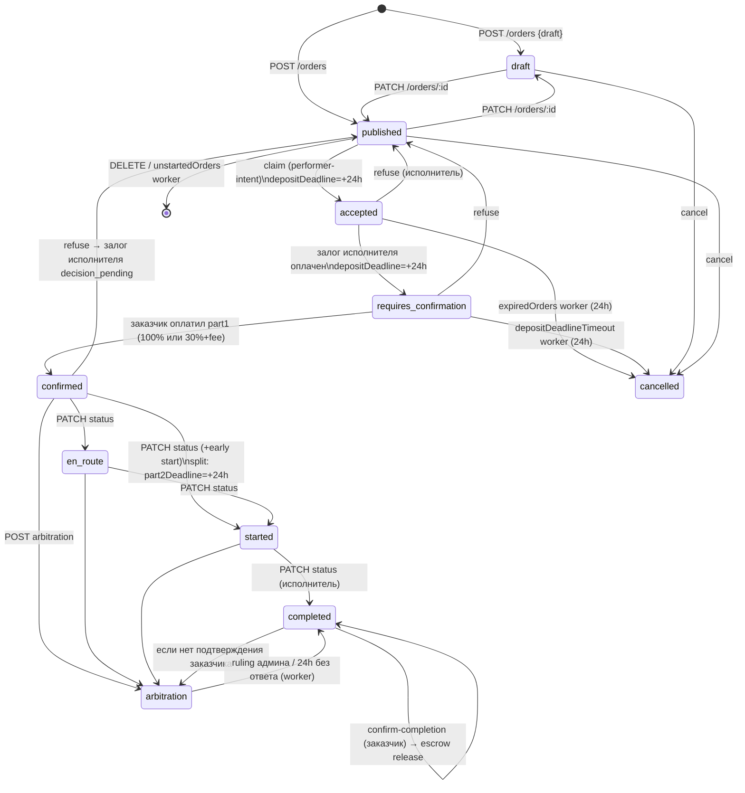
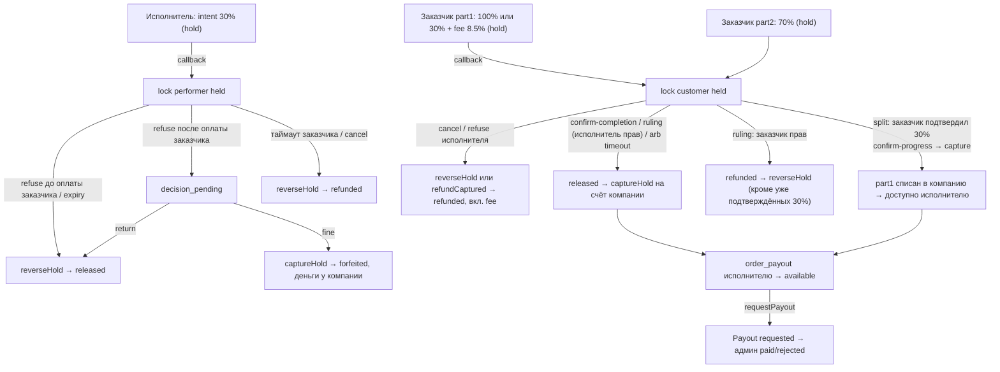

# Карта процесса Dragonfly: заказ → деньги → приложение

Документ собран по коду (backend, worker, app) 2026-11-25. Документы в
`admin/docs/*` и `endpoints.md` частично устарели — при расхождении верить
этой карте и коду. Пути ниже: `BE` = `backend/src`, `API` =
`backend/src/app/api/v1`, `WK` = `worker/src`, `APP` = `app`.

---

## 1. Правила и константы (источник истины)

| Правило | Значение | Где |
|---|---|---|
| Залог исполнителя | 30% бюджета, LiqPay `hold` | `BE/lib/deposit.ts` `DEPOSIT_RATE` |
| Срок оплаты залога исполнителем после claim | **24 ч** | `DEPOSIT_DEADLINE_HOURS` (BE, WK, APP) |
| Срок оплаты заказчиком после оплаты исполнителя | 24 ч | `CUSTOMER_COUNTER_DEPOSIT_DEADLINE_HOURS` |
| План оплаты заказчика | 1–2 календарных дня (Kyiv) или без дат → 100% сразу; 3+ дней → 30% сразу + 70% (part 2) | `customerPaymentPlan` `BE/lib/deposit.ts` |
| Срок оплаты part 2 (70%) | 24 ч от старта работ | `PART2_DEADLINE_HOURS`, `part2DeadlineFor` |
| Напоминание о part 2 | за 12 ч до дедлайна | `WK/workers/part2Deadline.worker.ts` `PART2_REMINDER_LEAD_MS` |
| Комиссия Dragonfly | 8.5% бюджета, только в первом платеже заказчика | `BE/lib/fees.ts` `SERVICE_FEE_RATE` |
| Комиссия LiqPay (для отчётов админки) | 2% | `BE/lib/fees.ts` `LIQPAY_FEE_RATE` |
| Ответ в арбитраже | 24 ч | `BE/lib/arbitrationDeadlines.ts` |
| Все платежи LiqPay | `action=hold` | `BE/services/liqpay.service.ts` |
| **Списание денег заказчика** | только по подтверждению заказчика: 30% — `POST /orders/:id/confirm-progress` (после фиксации исполнителем 30%), 70% и 100%-заказы — `confirm-completion`. Иначе — арбитраж | `deposit.service.ts` `settlePendingLock`, `captureCustomerInitialDeposit` |
| Смысл `released` для заказчика | **capture** на счёт компании → доступно исполнителю к выводу. Возврат заказчику — только `refunded` | `settlePendingLock` |
| Подтверждённые 30% | помечаются `providerRaw.captured=true`; не возвращаются заказчику и не списываются повторно (в т.ч. если заказчик потом выиграл арбитраж) | `isIntentCaptured` |

---

## 2. Жизненный цикл заказа

Статус — строка (`schema.prisma` Order.status), допустимые переходы описаны в
`BE/lib/orderStatus.ts`, но большинство роутов **не** вызывают `canTransition`,
а проверяют статусы сами.

### 2.1 Переходы (кто и где)

| Переход | Триггер | Побочные эффекты |
|---|---|---|
| published → accepted | `API/marketplace/orders/[orderId]/deposits/performer-intent` → `claimOrderForPerformer` (`BE/services/deposit.service.ts`) | условный `updateMany`; intent исполнителя 30% (hold) |
| accepted → requires_confirmation | LiqPay callback / confirm / sync → `confirmDeposit` | lock исполнителя `held`; новый дедлайн 24ч для заказчика; уведомления |
| requires_confirmation → confirmed | то же, роль customer, part 1 | lock заказчика `held` (сумма без комиссии) |
| part 2 оплачен (статус не меняется) | `confirmDeposit` part 2 | lock заказчика = бюджет; `customerPart2Deadline=null` |
| accepted → cancelled | `WK/workers/expiredOrders.worker.ts` | все locks release; уведомления |
| requires_confirmation → cancelled | `WK/workers/depositDeadlineTimeout.worker.ts` | lock исполнителя refund; `riskScore-1` заказчику |
| * → published (refuse) | `API/orders/[orderId]/refuse` | из confirmed: lock исполнителя → `decision_pending`, заказчику refund |
| decision_pending → released / forfeited | `API/orders/[orderId]/performer-deposit-decision` | решение заказчика (вернуть / штраф) |
| confirmed/en_route → started | `API/orders/[orderId]/status` | split: дедлайн part 2 +24ч |
| (split) подтверждение 30% | `API/orders/[orderId]/confirm-progress` (заказчик, после progress ≥30%) | capture part 1 → доступно исполнителю; маркер `PART1_CONFIRMED_NOTE` |
| started → completed | `API/orders/[orderId]/status` | completedAt, matches удаляются |
| completed → (закрыт) | `API/orders/[orderId]/confirm-completion` | все locks → release → settlement; маркер `COMPLETION_CONFIRMED_NOTE` |
| * → arbitration | `API/orders/[orderId]/arbitration` | ArbitrationCase, дедлайн ответа другой стороны 24ч |
| arbitration → completed | `API/admin/arbitration/[caseId]/ruling` | проигравший forfeited, победитель released |
| arbitration → completed | `WK/workers/arbitrationResponse.worker.ts` | **все locks released** |
| админ: cancel / status | `API/admin/orders/[id]/*` | обходит часть побочных эффектов (см. I-20) |

### 2.2 Таймеры

| Таймер | Длительность | Исполнитель | Результат |
|---|---|---|---|
| `depositDeadline` (accepted) | 24ч | expiredOrders | → cancelled |
| `depositDeadline` (requires_confirmation) | 24ч | depositDeadlineTimeout | → cancelled, refund исполнителю |
| `customerPart2Deadline` | 24ч от старта | part2Deadline | **только уведомления** (напоминание за 12ч, просрочка) |
| Ответ в арбитраже | 24ч | arbitrationResponse | case закрыт, order completed, всё released |
| Опубликован > 24ч | — | staleOrders | уведомление |
| Не начат после `dateFrom` | день | unstartedOrders | hard delete (без locks/intents) |
| Повтор settlement | `*_pending` > 2 мин | scheduler, каждые 5 мин | `retryPendingEscrowSettlements` |
| confirmed, но не начат | — | **нет** | — |
| completed, но не подтверждён | — | **нет** | — |
| decision_pending | — | **нет** | — |

---

## 3. Деньги

Модели: `PaymentIntent` (платёж в LiqPay, role/part, status
`pending|paid|duplicate|released|refunded|forfeited`), `EscrowLock` (один на
`orderId+role`, status `held → *_pending → released|refunded|forfeited`, плюс
`decision_pending`), `Payout` (вывод исполнителя, ручной). `Wallet`,
`Transaction`, `PaymentRequest` — legacy, ledger их не читает.

### 3.1 Ledger: kind × status → поле сводки (`BE/lib/finance/ledger.ts`)

| Роль | kind | status entry | Поле summary |
|---|---|---|---|
| customer | `customer_deposit` / `customer_balance` | `in_escrow` (lock held / forfeit_pending) | `inEscrowUah` |
| | | `completed` (released / release_pending / forfeited) | `earnedOrPaidUah` |
| | | `refunded` | — |
| customer | `service_fee` | `completed` | `feesPaidUah` **и** `earnedOrPaidUah` |
| customer | `customer_refund`, `performer_deposit_forfeit` | `refunded` / `completed` | `refundedUah` |
| performer | `performer_deposit` | `in_escrow`, `decision_pending` | `inEscrowUah` (после фикса — только эти) |
| | | `unlock_pending`, `returned` | — |
| | | `forfeited` | `refundedUah` («Штрафи») |
| performer | `order_payout` | `completed` | `earnedOrPaidUah`, `availableUah` |
| | | `settling` | только админ `settlingUah` |
| | | `in_escrow` | — (после фикса не попадает в escrow исполнителя) |
| performer | `withdrawal` | `paid` / `requested` / `rejected` | `withdrawnUah` / `pendingWithdrawalUah` |

App: «Сплачено Виконавцю» у заказчика = `earnedOrPaidUah − feesPaidUah`
(`APP/app/(tabs)/wallet.tsx`), арифметически верно, но входные данные
искажены (I-4, I-12).

---

## 4. Приложение ↔ backend (кратко)

| Статус | Заказчик видит / делает | Исполнитель видит / делает |
|---|---|---|
| published | «Очікує виконавця», удалить | marketplace → «Прийняти» (claim + оплата залога) |
| accepted | ⚠ кнопка «Оплатити» (backend отклонит, I-10) | «Внести гарантійну суму», отказаться; нет таймера 24ч |
| requires_confirmation | «Оплатити» + таймер 24ч | ожидание, отказаться |
| confirmed | early start да/нет, арбитраж | выезд / старт, early start, арбитраж, отказ |
| en_route | арбитраж | «Розпочати роботу», арбитраж |
| started | оплата 70% (split), арбитраж | прогресс 30/100%, «Завершити роботу» (⚠ без проверки 70%, I-8) |
| completed | ⚠ **нет кнопки подтверждения** (I-6) | «Виконано та оплачено» (преждевременно) |
| arbitration | чат арбитража | чат арбитража |

---

## 5. Реестр проблем

Приоритет: **P0** — потеря/неверное движение денег или безопасность;
**P1** — зависшие заказы/деньги, неверные суммы; **P2** — UX, тексты, docs.
Статус: `open` / `fixed` / `decision` (нужно бизнес-решение).

### P0

| ID | Проблема | Где | Статус |
|---|---|---|---|
| I-1 | **Подтверждение оплаты без оплаты.** `/payments/:id/confirm` принимает те же `data`, что сервер выдал для checkout (`isCheckoutReplay`), → intent `paid` без `payment_id`. Settlement пропускает, ledger начисляет исполнителю. | `BE/services/deposit.service.ts` (`isCheckoutReplay`), `API/payments/[id]/confirm` | open |
| I-2 | **Release заказчика = возврат денег заказчику.** Для customer lock `released` → `reverseHold` (hold снимается, деньги на карте заказчика, вкл. комиссию), а ledger показывает исполнителю выплату. Для 100%-заказов ничего не списывается вообще. | `settlePendingLock` в `deposit.service.ts`; вызовы: confirm-completion, ruling, arbitrationResponse worker, admin status | fixed |
| I-3 | Part 1 списан (`captureCustomerInitialDeposit`), но intent остаётся `action=hold` → потом `reverseHold` по уже списанному платежу → вероятно ошибка LiqPay и бесконечный retry `release_pending`; part 2 в этом цикле не обрабатывается. Capture может выполниться дважды (progress 30% в en_route + started). | `deposit.service.ts` capture/settle, `API/orders/[orderId]/progress`, `.../status` | fixed |
| I-4 | **Ledger читает только intents `paid`**, а settlement переводит их в `released/refunded/forfeited` → после расчёта платежи, комиссии и штрафы исчезают из кошелька; «Сплачено Виконавцю» → ~0; доход компании в админке падает. | `BE/services/finance.service.ts` (`status: "paid"`), `adminFinance.service.ts` | fixed |
| I-5 | **Upsert EscrowLock не обновляет `userId`** → залог и выплата нового исполнителя приписываются предыдущему (он может их вывести). У PaymentIntent нет `userId`. | `deposit.service.ts` upsert lock, `finance.service.ts`, `ledger.ts` `isMyPerformerOrder` | open |
| I-6 | **Заказчик не может подтвердить выполнение в app** (кнопку убрали в `40571c5`), автоподтверждения нет → escrow не освобождается, рейтинг недоступен. | `APP/app/active-work.tsx`, `API/orders/[orderId]/confirm-completion` | fixed |
| I-7 | **GET финансов пишет в БД**: `loadLedgerInput` переводит `held → released` без settlement, если у завершённого заказа есть любое событие «Адмін:» → исполнитель получает доступный баланс без подтверждения заказчика. | `BE/services/finance.service.ts` | fixed |

### P1

| ID | Проблема | Где | Статус |
|---|---|---|---|
| I-8 | Split: исполнитель может `started → completed` без оплаты 70% (`PATCH status` не проверяет, `progress` проверяет) → заказ в тупике: оплатить part 2 нельзя (нужен started), подтвердить нельзя, ruling требует part 2. Частично исправлено: part 2 теперь можно оплатить и в `completed` (до подтверждения), app показывает «Оплатити залишок» → «Підтвердити виконання». Ruling без part 2 — open. | `API/orders/[orderId]/status`, `progress`, `customer-intent`, `admin/arbitration/.../ruling` | partial |
| I-9 | `decision_pending`: нет UI в app, нет таймаута; заказ published, но скрыт с биржи, при этом matching его рассылает; новый claim возможен → оплата нового исполнителя помечается `duplicate`; DELETE каскадно удаляет lock. | `refuse`, `performerDepositDecision.ts`, `marketplaceEligibility.ts`, `WK/lib/matchingQuery.ts` | decision |
| I-10 | Заказчик может создать платёж в `accepted` (app показывает «Оплатити», route разрешает), но `confirmDeposit` → 409 → hold висит, intent pending. Также поздние платежи после cancel/refuse/expiry. | `API/orders/[orderId]/deposits/customer-intent` (`accepted`), `transitionForConfirm`, `APP/components/CustomerOrderCard.tsx`, `active-work.tsx` | open |
| I-11 | Безусловные `order.update` по статусу (гонки): depositDeadlineTimeout может перезаписать только что `confirmed` → `cancelled` с held lock заказчика. То же в expiredOrders, cancel, status, arbitration, refuse, edit. | соответствующие роуты/воркеры | open |
| I-12 | Комиссия 8.5%: фактически возвращается при отмене (reverse всего hold), тексты говорят «не повертається» / «утримується тільки за виконані»; `feesPaidUah` считает комиссии отменённых. | `ledger.ts`, `APP/app/(tabs)/wallet.tsx`, `fees.ts` | decision |
| I-13 | Штраф исполнителя показывается заказчику как доход («надходять на ваш баланс або картку»), но деньги остаются у компании; выплат заказчику нет. | `ledger.ts` `performer_deposit_forfeit`, `wallet.tsx` | decision |
| I-14 | Арбитраж: маппинг исходов в ledger неверен (forfeited customer lock = «передано виконавцю»); таймаут ответа отпускает всё без штрафа молчащему; можно открыть арбитраж повторно после решения; confirm-completion проверяет legacy `ArbitrationResolution`. | `ruling`, `arbitrationResponse.worker`, `arbitration` route, `confirm-completion` | open |
| I-15 | Задачи таймеров с фиксированным `jobId` после 5 неудач больше не ставятся → заказ навсегда в accepted/requires_confirmation. `customerProfile.update` падает без профиля. | `WK/workers/expiredOrders`, `depositDeadlineTimeout`, `WK/queues/queues.ts` | open |
| I-16 | `ensureIntentServerUrl` пересоздаёт intent без `part` → part 2 становится part 1 (снова 30% + комиссия). | `deposit.service.ts` | open |
| I-17 | Lock исполнителя `refunded/refund_pending` не смаплен → висит в «В ескроу» исполнителя. | `ledger.ts` performer_deposit | open |
| I-18 | Аванс 30% исполнителю становится доступным по его же отчёту о прогрессе, даже если capture не удался. | `ledger.ts` order_payout part 1, `captureCustomerInitialDeposit` | fixed |
| I-19 | Подтверждение part 2 без проверки статуса заказа и без защиты от двойной оплаты. | `confirmDeposit` part 2 | open |
| I-20 | Админские переходы обходят логику: started без дедлайна part 2 и capture; arbitration без ArbitrationCase; completed без part 2 и подтверждения. | `API/admin/orders/[id]/status` | open |
| I-21 | Нет таймеров для confirmed-не-начат, completed-не-подтверждён, decision_pending → деньги могут висеть бессрочно. | worker scheduler | decision |

### P2

| ID | Проблема | Где | Статус |
|---|---|---|---|
| I-22 | expiredOrders ставит `cancelled`, но пишет заказчику «повернуте в біржу» и ставит matching; исполнителю — «гарантійна сума повернута», хотя он не платил. | `WK/workers/expiredOrders.worker.ts` | decision (cancel или re-publish?) |
| I-23 | Срок part 2: тексты «до кінця третього дня», код — 24ч от старта; `PART2_DEADLINE_DAY` не используется. | `APP/app/create-order.tsx`, `ledger.ts`, `BE/lib/deposit.ts` | open |
| I-24 | Сумма к оплате с главной заказчика без комиссии (`customerImmediateUah` вместо `customerPayableNow`). | `APP/hooks/useCustomerOrders.ts`, `CustomerOrderCard.tsx`, `payment.tsx` | open |
| I-25 | Realtime: app слушает `order:status_changed`, backend шлёт `order.status_changed` → список не обновляется в реальном времени. | `APP/hooks/useCustomerOrders.ts`, `RoleHeader.tsx`, `BE/realtime/domainEvents.ts` | open |
| I-26 | «Розрахунок закрито» / «виконано та оплачено» показываются до подтверждения заказчика; «До виплати: budget» не учитывает аванс. | `CustomerOrderCard.tsx`, `ContractsListView.tsx`, `active-work.tsx` | open |
| I-27 | Просроченный заказ: кнопка «Видалити» → DELETE → 403; нужен `PATCH /cancel`. | `active-work.tsx` | open |
| I-28 | После `PATCH status` app делает `setOrder(toUiOrder(res.order))`, а ответ — только `{id,status}` → экран «ломается» до refetch. | `active-work.tsx`, `API/orders/[orderId]/status` | open |
| I-29 | Экран отказа: «застава буде утримана», правило 72ч — в backend нет. | `APP/app/refuse-order.tsx` | open |
| I-30 | Маршрут исполнителя ведёт в Полтаву: `/performer/active-work` не отдаёт координаты, app подставляет fallback. | `API/performer/active-work`, `active-work.tsx`, `ContractsListView.tsx` | open |
| I-31 | `en_route` выпадает из списков (active group, billing, stats, баланс в app, escrow-строка карточки). | `API/orders/route.ts`, `billing`, `marketplace/stats`, `CustomerOrderCard.tsx`, `useCustomerOrders.ts` | open |
| I-32 | Хардкод чисел и разное округление (0.085, 0.3, 0.7; app — до гривны, backend — до копейки; billing — 10%). | `active-work.tsx`, `create-order.tsx`, `APP/lib/deposit.ts`, `API/orders/route.ts`, `billing` | open |
| I-33 | Несовпадение полей: app читает `customerDepositAmount`/`customerPayTotalAmount`, `depositCustomer.paid`; backend отдаёт `customerImmediateAmount`/`customerPayableNow`, `part1Paid/part2Paid`. | `active-work.tsx`, `order-details.tsx`, `BE/lib/orderDetail.ts` | open |
| I-34 | Нет таймера 24ч для исполнителя в accepted (backend отдаёт `depositDeadline`). | `active-work.tsx`, `order-details.tsx` | open |
| I-35 | Кошелёк: даты 1970 (`new Date(0)`), возврат залога дважды, `availableAdvances` показывает уже выведенные авансы. | `ledger.ts`, `wallet.tsx` | open |
| I-36 | `worker/src/services/deposit.service.ts` устарел (нет плана оплаты, part 2, duplicate). Сейчас не вызывается, но это ловушка. | `WK/services/deposit.service.ts` | open |
| I-37 | Early start не привязан к исполнителю; гонки confirm-completion и рейтинга (нет unique). | `status` route, `confirm-completion`, `orderRating.ts` | open |
| I-38 | Документация: `admin/docs/04-order-lifecycle.md` описывает удалённые request-payment / resolve; `backend/AGENTS.md` — expiredOrders/depositDeadlineTimeout → published. | docs | open |

### Исправлено

| Что | Коммит |
|---|---|
| «В ескроу» исполнителя считает только его залог | backend `edafddd`, app `6f74056` / `0e3de77` |
| Статус `decision_pending` в app (тип, подпись, цвет) | app `4453cd8` / `b2e797a` |
| Деньги заказчика списываются на счёт компании только по его подтверждению: 30% (`confirm-progress`), 70%/100% (`confirm-completion`); выигрыш заказчика в арбитраже = возврат; GET финансов больше не пишет в БД; журнал не теряет рассчитанные платежи (I-2, I-3, I-4, I-7, I-18) | backend/worker/app, 2026-11-25 |
| Кнопка «Підтвердити виконання» у заказчика (I-6); оплата 70% после `completed` (I-8, частично); одна кнопка вывода у исполнителя | см. git log app/backend |
| Срок залога исполнителя 12ч → 24ч (код + docs) | backend `9225189`, worker `cedbaa2`, admin `4edc618`, app `7da3ddd` |

---

## 6. Решения, которые нужны от бизнеса

1. ~~Что значит «release» денег заказчика~~ — решено: capture на счёт компании
   по подтверждению заказчика (30% отдельно, 70%/100% при закрытии).
2. **Возвращается ли комиссия 8.5% при отмене** (I-12) — сейчас возвращается
   фактически, тексты говорят обратное.
3. **Куда идёт штраф исполнителя** (I-13): остаётся у компании или
   выплачивается заказчику?
4. **decision_pending по умолчанию** (I-9): через сколько часов и что
   (вернуть / удержать), если заказчик не решил.
5. **Автоподтверждение выполнения** (I-6, I-21): через сколько часов после
   `completed`, если заказчик молчит.
6. **Просрочка залога исполнителя** (I-22): отменять заказ или возвращать
   на биржу?
7. **Таймаут арбитража** (I-14): что получает молчащая сторона.
